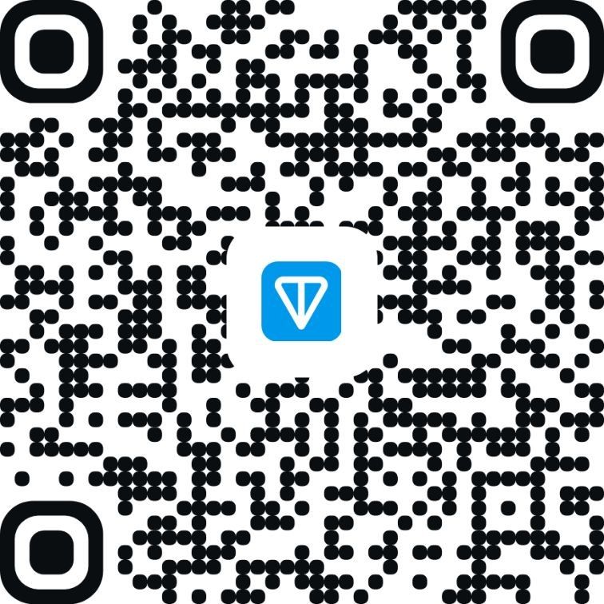
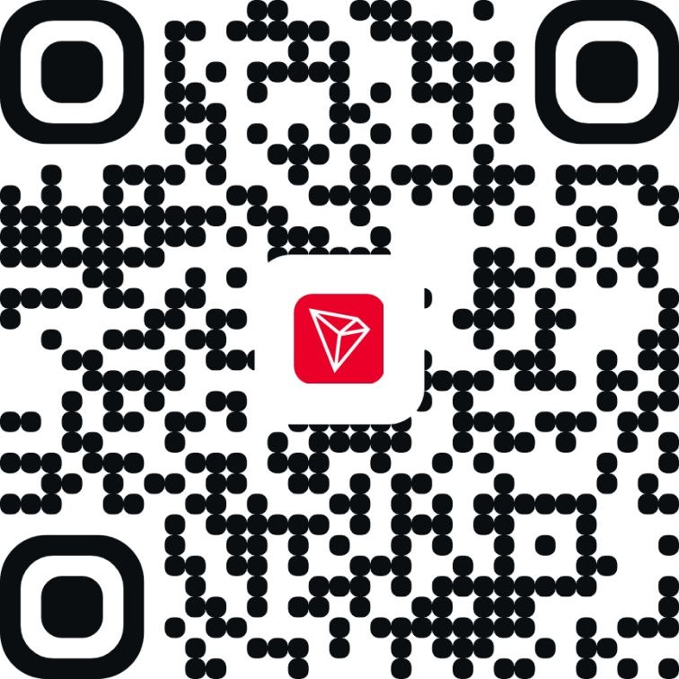
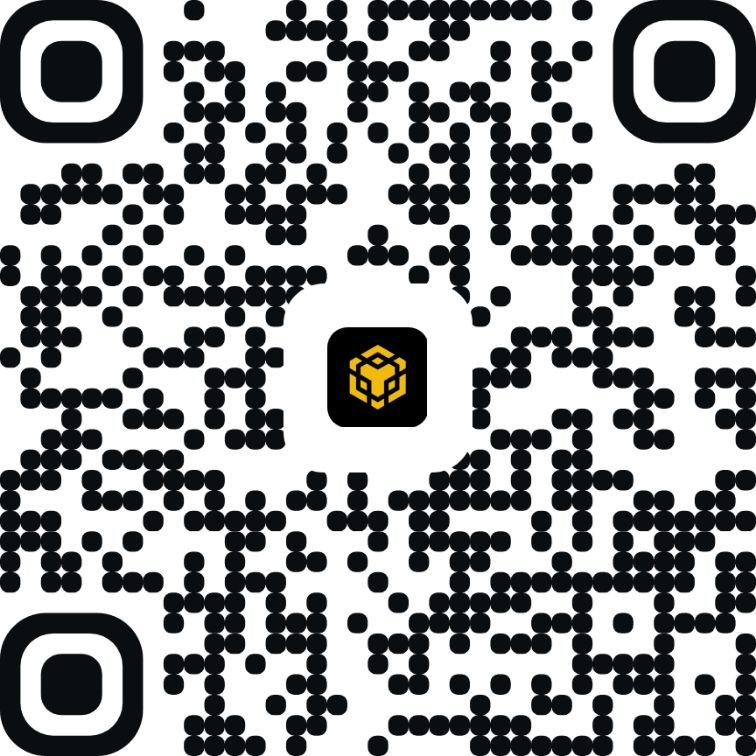

# Support KoroshSF ❤️

Thank you for using these free applications.

If FocusGuard or SleepGuard help you, you can support future development with a voluntary crypto donation.

## Important
Please double-check the selected network before sending any funds.

Sending funds on the wrong network may result in permanent loss.

---

## TON

**Network:** TON  
**Address:**  
`UQC4dxa0j9QhjLbUQ_d0XqmegWLCYpchUEh-NHbFO-7OHkW-`

Scan the QR code below:

---

## TRON (TRX)

**Network:** TRON  
**Coin:** TRX  
**Address:**  
`TVELaZWdHzsHZVjA1bSr6s1dTKw1WPUCvm`

Scan the QR code below:

---

## USDT (TRC20)

**Network:** TRON  
**Token:** USDT (TRC20)  
**Address:**  
`TVELaZWdHzsHZVjA1bSr6s1dTKw1WPUCvm`

Scan the QR code below:

---

## BNB Smart Chain (BNB)

**Network:** BNB Smart Chain (BSC)  
**Coin:** BNB  
**Address:**  
`0x2F76975662A60FeD5EeD3E2c2D241720F1f82f63`

Scan the QR code below:

---

## USDT (BEP20 / BSC)

**Network:** BNB Smart Chain (BSC)  
**Token:** USDT (BEP20)  
**Address:**  
`0x2F76975662A60FeD5EeD3E2c2D241720F1f82f63`

Scan the QR code below:

---

## Developer
**KoroshSF**

All donations are voluntary and help support maintenance and future development.
